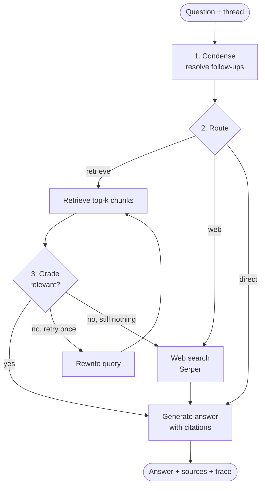

<div align="center">

# 🧠 Agentic RAG API

**A production-style FastAPI service where an agent answers questions about your documents - it decides when to retrieve, checks its own evidence, rewrites failed searches and falls back to the web.**


</div>

---

## ✨ Highlights

- 🔁 **Corrective RAG agent** (LangGraph): condense → route → retrieve → *grade* → rewrite → generate, with web-search fallback.
- 💬 **Conversations with memory** - persistent threads stored in SQLite checkpoints; follow-ups like *"and who leads that project?"* are resolved automatically.
- ⚡ **Streaming** - Server-Sent Events with per-node `step` events and live `token` events.
- 📚 **Document ingestion** - TXT, Markdown, CSV and PDF; chunked and embedded **locally** (ONNX via fastembed - no embedding API, no GPU).
- 🔐 **API-key auth** - keys are minted by an admin endpoint and stored only as SHA-256 hashes; every key sees only its own documents and threads.
- 🛡️ **Hardening** - upload size/type limits, per-key rate limiting, request IDs, structured JSON logs, consistent error format.
- 🧩 **Modular & testable** - dependency-injected container, swappable embedder / LLM / vector store, and a deterministic fake LLM so the whole suite runs offline.
- 🐳 **Docker** - non-root image with the embedding model baked in, health check, compose file, CI workflow.

## 🧭 Architecture



| Step | What it does |
|---|---|
| **Condense** | Turns *"how many engineers does the team have?"* into a standalone question using only the user's earlier questions |
| **Route** | An LLM picks `retrieve`, `web` or `direct`; it is told which documents the user uploaded. Impossible choices (web without a key, retrieve without documents) are corrected |
| **Grade** | The model checks that the passages really help; irrelevant passages are never cited |
| **Rewrite** | One query rewrite (configurable), then fall back to web search if available |
| **Generate** | Answers from numbered context, citing `[1]`, `[2]`... Sources are returned separately |

## 🚀 Quick Start

### With Docker (recommended)

```bash
git clone <this-repo> && cd agentic-rag-api
cp .env.example .env            # set GROQ_API_KEY and ADMIN_TOKEN
docker compose up --build
```

Interactive docs: **http://localhost:8000/docs**

### Without Docker

```bash
python -m venv .venv && source .venv/bin/activate
pip install -r requirements-dev.txt
cp .env.example .env
uvicorn app.main:app_factory --factory --reload
```

### Try it offline (no keys, no downloads)

```bash
LLM_BACKEND=fake EMBEDDING_BACKEND=fake ADMIN_TOKEN=dev uvicorn app.main:app_factory --factory
```

## 📡 API

All `/v1` routes except `/v1/admin/*` need `X-API-Key: <key>`.

| Method | Path | Description |
|---|---|---|
| `GET` | `/health`, `/ready` | Liveness / readiness |
| `POST` | `/v1/admin/keys` | Create an API key (`X-Admin-Token`) - the key is shown once |
| `GET` / `DELETE` | `/v1/admin/keys[/{id}]` | List / revoke keys |
| `POST` | `/v1/documents` | Upload a document (multipart) |
| `GET` | `/v1/documents` | List your documents |
| `DELETE` | `/v1/documents/{id}` | Delete a document and its chunks |
| `POST` | `/v1/search` | Raw semantic search over your chunks |
| `POST` | `/v1/chat` | Ask the agent (JSON answer with sources and trace) |
| `POST` | `/v1/chat/stream` | Same, as Server-Sent Events |
| `GET` | `/v1/threads/{thread_id}` | Conversation history |

### Example

```bash
# 1. create a key (admin)
curl -X POST localhost:8000/v1/admin/keys \
  -H "X-Admin-Token: $ADMIN_TOKEN" -H "Content-Type: application/json" \
  -d '{"name": "demo"}'
# -> {"api_key": "rag_...", ...}

# 2. upload a document
curl -X POST localhost:8000/v1/documents -H "X-API-Key: $KEY" -F "file=@notes.pdf"

# 3. ask
curl -X POST localhost:8000/v1/chat -H "X-API-Key: $KEY" -H "Content-Type: application/json" \
  -d '{"question": "What is the main risk for Atlas?"}'
```

```json
{
  "thread_id": "731f92bc03cf4ccf",
  "answer": "The main risk for Atlas is the data migration from the legacy wiki【1】.",
  "standalone_question": "What is the main risk for Atlas?",
  "route": "retrieve",
  "steps": ["condense", "route:retrieve", "retrieve", "grade:yes", "generate"],
  "sources": [{"type": "document", "title": "atlas.txt", "score": 0.84, "...": "..."}]
}
```

Continue the conversation by sending the same `thread_id`.

### Streaming events

```text
event: step    data: {"node": "route"}
event: token   data: {"text": "The "}
event: sources data: [{...}]
event: done    data: {"thread_id": "...", "route": "retrieve"}
```

`error` is emitted instead of `done` if generation fails.

## ⚙️ Configuration

Environment variables (see [`.env.example`](.env.example)):

| Variable | Default | Description |
|---|---|---|
| `GROQ_API_KEY` | - | LLM access (`LLM_BACKEND=groq`) |
| `GROQ_MODEL` | `openai/gpt-oss-120b` | Any Groq chat model |
| `SERPER_API_KEY` | - | Enables the web-search tool |
| `ADMIN_TOKEN` | - | Required to create API keys (admin routes are disabled if empty) |
| `EMBEDDING_MODEL` | `BAAI/bge-small-en-v1.5` | fastembed model |
| `CHUNK_SIZE` / `CHUNK_OVERLAP` / `TOP_K` | `800` / `100` / `4` | Retrieval tuning |
| `MAX_REWRITES` | `1` | Query rewrites before falling back |
| `RATE_LIMIT_PER_MINUTE` | `60` | Per API key |
| `MAX_UPLOAD_MB` | `10` | Upload limit |
| `DATABASE_URL`, `CHECKPOINT_PATH` | `./data/...` | SQLite locations (persist `/app/data` in Docker) |
| `LLM_BACKEND`, `EMBEDDING_BACKEND` | `groq`, `fastembed` | Use `fake` for offline runs and tests |

## 📁 Project Structure

```
app/
├── main.py              # App factory, middleware (request id, access log)
├── container.py         # Builds and holds all long-lived dependencies
├── core/                # config, security (key hashing, rate limiter), errors, logging
├── db/                  # SQLAlchemy models + session
├── schemas/             # Pydantic request/response models
├── api/
│   ├── deps.py          # Auth, rate-limit and DB dependencies
│   └── routes/          # health · admin · documents · chat
├── services/            # embeddings · vectorstore · ingestion · retrieval · llm · chat helpers
└── agent/               # LangGraph: state · prompts · nodes · tools · graph
tests/                   # unit + end-to-end tests (fake LLM / embeddings, offline)
```

## 🧪 Testing

```bash
pytest -q          # 22 tests, ~4 seconds, no network
ruff check .
```

The suite covers auth, key revocation, tenant isolation, upload validation, retrieval, every agent path (retrieve / direct / rewrite), conversation memory, SSE streaming, rate limiting, and regression tests for two real-model bugs found while testing against Groq (router ignoring uploaded documents; follow-up questions absorbing details from earlier answers).

## 🔧 Design notes & limits

- **Vector store**: brute-force cosine search over normalised vectors in SQLite - fast for thousands of chunks per key. `SqlVectorStore` has three methods (`add`, `count`, `search`); implement them on pgvector / Qdrant to scale.
- **Rate limiter** is in-process; use Redis if you run several workers.
- **Schema** is created on startup; add Alembic migrations before evolving the models in production.
- **Security**: API keys are hashed at rest; admin token is compared in constant time; PDF/text parsing is bounded by the upload limit.

## 🛠️ Tech Stack

`FastAPI` · `LangGraph` · `LangChain` · `Groq` · `fastembed (ONNX)` · `SQLAlchemy 2` · `SQLite` · `pypdf` · `Docker` · `pytest` · `ruff`
